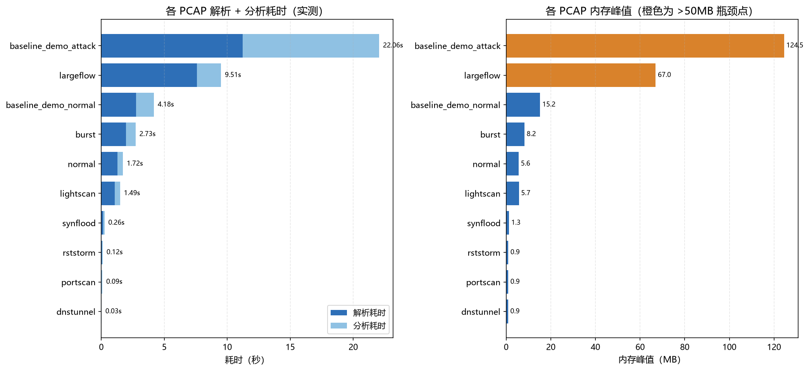
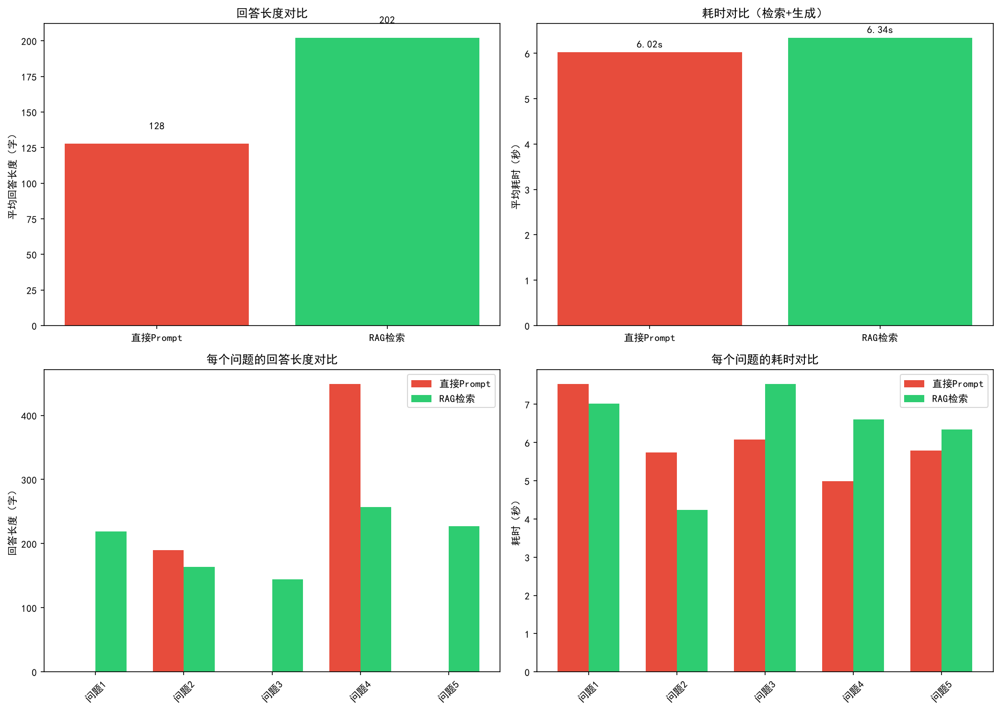

# AI Network Security Analyzer | AI 网络安全分析系统

> **中文**：AI 辅助的网络取证分析系统 — 流式 PCAP 分析 + 三引擎 Stacking 融合检测 + LLM 威胁研判 + RAG 安全知识问答
>
> **English**: AI-Assisted Network Forensics System — Streaming PCAP Analysis + Three-Engine Stacking Fusion Detection + LLM Threat Assessment + RAG Security Knowledge Q&A

[](https://www.python.org/)
[](https://fastapi.tiangolo.com/)
[](https://www.gradio.app/)
[](LICENSE)
[](#测试)
[](https://github.com/LJY20030728/ai-network-security-analyzer/actions/workflows/ci.yml)

**[中文版](#目录) | [English Version](README_EN.md)**

---

## 目录

- [项目简介](#项目简介)
- [核心特性](#核心特性)
- [技术架构](#技术架构)
- [快速开始](#快速开始)
- [使用指南](#使用指南)
- [API 文档](#api-文档)
- [评测结果](#评测结果)
- [项目结构](#项目结构)
- [开发指南](#开发指南)
- [更新日志](#更新日志)
- [常见问题](#常见问题)
- [技术决策记录（ADR）](docs/技术决策记录.md) — 每个关键决策的取舍、代价与实测数据
- [许可证](#许可证)

---

## 项目简介

传统网络取证分析依赖安全分析师用 Wireshark 逐包查看 PCAP 文件，效率极低且高度依赖个人经验。规则引擎虽然能自动化检测，但对未知攻击和大流量变种漏报严重（实测规则引擎在 UNSW-NB15 上攻击召回仅 0.0001）。

本项目是一个 **AI 辅助的离线网络取证分析工具**，实现了：
- **三引擎 Stacking 融合检测（13维特征）**：规则引擎（9类阈值规则，含TCP+UDP+QUIC）+ EWMA 时序基线 + 孤立森林，三者结论交由 Stacking 元学习器（LogisticRegression）融合；置信度来源始终如实标注。v3.4.0 修复孤立森林形同虚设 bug，孤立森林异常分获得元学习器最高权重
- **LLM 威胁研判**：大模型将技术告警翻译为人类可读的威胁分析，配套三层输出校验（失败哨兵 / 交叉验证 / 人工复核标记）—— **注意：是合理性校验而非事实核查，见下文能力边界**
- **RAG 安全知识问答**：本地向量库（BGE ONNX + ChromaDB，1687 片段），混合检索（向量 + BM25 + RRF）+ 重排序
- **全流程闭环**：检测 → 分析 → 取证报告（五要素）→ 历史知识库（跨样本关联/趋势分析）
- **流式处理**：单遍流式解析，内存 O(活跃流+窗口)，可处理 GB 级 PCAP
- **预置默认基线**：随安装包分发默认基线，首次开箱即用无需手动学习

### 为什么选择这个项目

| 维度 | 说明 |
|------|------|
| **算法深度** | 三引擎 Stacking 融合（规则/时序基线/无监督，13维特征）、孤立森林异常分统计+top维度风险、UDP/QUIC完整检测、自适应阈值、STL 时序分解、逐包流式特征聚合 |
| **AI 工程** | 三层输出校验（含能力边界实测）、RAG 混合检索+重排序、本地向量推理 |
| **工程质量** | 306 单元测试全绿、FastAPI + Pydantic、SQLite WAL、DPAPI 加密、全局异常处理、CI（含 Windows/DPAPI 专项 job）、依赖锁定 |
| **轻量可移植** | 平均内存峰值 23MB、本地推理不依赖外部服务、Windows .exe 打包 |
| **可验证** | 所列指标均有对应评测脚本与结果文件；无法复现的旧指标已删除而非保留 |

---

## 核心特性

### 🔍 三引擎 Stacking 融合检测

系统在同一遍流式解析中并行维护 3 个检测引擎的输入，各引擎结论交由 Stacking 元学习器融合为 PCAP 级判定。

| 引擎 | 类型 | 运行时角色 | 说明 |
|------|------|------|------|
| **规则引擎** | 阈值规则 | 活跃 | 11 类规则（**v3.4.4 提取为共享 `rule_detector.py`，流式与全量两条路径调用同一模块，消除重复代码**）（SYN 洪水 / 端口扫描 / DNS 隧道 / 大流量传输 / RST 风暴 / **UDP 洪水 / DNS 放大 / QUIC 连接风暴 / QUIC 长流异常 / QUIC 初始包比例 / QUIC 未知版本**），阈值全部来自 `config/settings.py`，可 `.env` 覆盖 |
| **时序基线** | EWMA + 中位数/MAD | 活跃 | 4 维度联合（窗口包数 / 字节数 / SYN 数 / 目的端口数），支持漂移检测与多维度联合告警。**预置默认基线**，首次开箱即用 |
| **孤立森林** | 无监督异常检测 | 活跃（**默认开启**） | 与基线同窗口输入，捕获维度间耦合异常。v3.4.0 修复 `to_dict()` 不输出异常分的 bug，孤立森林特征从 3 维扩展到 6 维 |

**融合方式**：三引擎输出被映射为 **13 维特征**，交 `ThreeEngineStacking`（`src/analysis/stacking_fusion.py`）融合：

1. **元学习器（默认路径）**：`models/stacking_meta_learner.joblib` —— LogisticRegression，引擎顺序 `[rule_based, baseline, isolation_forest]`。加载时会**校验引擎顺序**，不匹配则拒绝加载以免给出错误判定。
   - 训练结果：1368 窗口样本（去重后），**GroupKFold CV F1 = 0.7425 ± 0.2700**
   - 特征权重前 5：`isolation_mean_score(-3.51)` > `rule_triggered_rules(+2.77)` > `rule_has_alert(+2.38)` > `baseline_multi_dim_triggered(+1.42)` > `isolation_anomaly_ratio(+0.99)`
   - **孤立森林的 `isolation_mean_score` 获得最高绝对权重**，证明 bug 修复后孤立森林真正参与决策（修复前权重为 0）
2. **固定权重回退**：元学习器缺失或预测异常时，退化为规则 0.4 / 基线 0.3 / 孤立森林 0.3 的人工权重，并通过 `confidence_source="weighted_fallback"` 明确标注「这不是模型输出」。

- **自适应阈值**：基于输入流量 P95 分位数动态调整，适应不同网络环境
- **STL 高级模式**：零依赖轻量级时序分解（趋势+季节性+残差），捕捉周期性偏离
- **可复现训练**：`python tools/train_stacking.py` 用仓库自带 golden + 混合样本逐窗口提取三引擎特征并训练元学习器（不依赖任何外部数据集）

### 🛡️ 置信度诚信标注

报告与界面中的每一个置信度都标注来源，避免把固定权重回退伪装成模型输出：

| `confidence_source` | 含义 | 展示文案 |
|---|---|---|
| `model` | 由三引擎 Stacking 元学习器 `predict_proba` 得出 | 元学习器输出（Stacking） |
| `weighted_fallback` | 元学习器不可用时的固定权重（人工先验，**非模型输出**） | 固定权重回退（非模型输出） |

同时 `stacking_fusion` 结果包含 `contributions`（三引擎各自的特征贡献占比，归一化为和为 1）与 `meta_learner_used`，便于判断该判定是否可信。

### 🤖 LLM 威胁研判 + 输出校验（原称"幻觉控制"）

- **威胁分析**：大模型自动生成威胁分析报告，跨告警关联，攻击链还原
- **三层校验**（模块名 `hallucination_control.py`，但**能力边界见下方警示**）：
  - `OutputValidator`：调用失败哨兵 / 空输出 / 长度 / 绝对化措辞 / 与证据一致性 / 未知技术名
  - `ConfidenceCrossValidator`：LLM vs 规则引擎 vs 三引擎融合交叉验证，矛盾检测
  - `ReviewMarker`：低置信度/矛盾结论自动标记"需人工复核"
- **思考过程可视化**：显示 LLM 分析和思考过程
- **多模型兼容**：智谱/DeepSeek/OpenAI 兼容接口

> #### ⚠️ 能力边界：这是「输出合理性校验」，**不是事实核查**
>
> 用 6 类对抗样本实测（构造"良好应答 / 虚构技术名 / 编造数值 / 自相矛盾 / 敷衍 / 空应答"）：
>
> | 用例 | 校验分 | 判定 | 说明 |
> |------|--------|------|------|
> | 良好应答（引用真实告警） | 1.000 | ✅ | — |
> | **虚构技术名**（编造 APT41 / T1055 / T1071） | **1.000** | ❌ **未识别** | 技术名提取器对 MITRE ID 返回空 → "未知技术"校验永不触发 |
> | **编造数值**（9999 告警 / 500GB 外泄 / 假 C2 域名） | **1.000** | ❌ **未识别** | 无任何数值接地检查项 |
> | 与证据矛盾（称"完全正常"但有 SYN Flood） | 0.867 | ⚠️ 仍算合格 | 一致性检查仅轻度降分 |
> | 敷衍（"看起来有点问题"） | 0.920 | ⚠️ 几乎不扣分 | — |
> | 空应答 | 0.000 | ✅ | — |
>
> **它真正能抓的**：LLM 调用失败（此前会把 API 报错认证为"校验通过/风险低"）、空输出、
> 绝对化措辞、输出长度异常、与引擎结论的矛盾。
> **它抓不到的**：编造的技术细节、编造的数值与 IOC、隐晦的事实错误。
>
> 要做到事实核查需要 **evidence grounding**（要求回答中每个告警类型/IP/数值都必须在
> `anomaly_report` 中出现）。这是已知的下一步方向，**当前未实现**。


### 📚 RAG 安全知识问答

- **本地向量库**：ChromaDB + BGE ONNX 推理（1687 条知识片段，零外部服务依赖）
- **混合检索**：BM25 关键词 + 向量语义，双通道召回
- **轻量级重排序**：标题 0.4 + 内容 0.3 + 元数据 0.2 + 向量距离 0.1 + 精确匹配加分
- **安全术语同义词扩展**：10 类中文→英文，提升跨语言检索效果
- **攻击类型知识库**：5 篇专业文档（SQL注入/勒索软件/钓鱼/内存马/中间人攻击），已导入向量库
- **对话历史持久化**：SQLite 存储，刷新不丢失
- **RAG 评测**：16 题黄金问答集双口径评测，Relevant Recall@5=1.0、MRR=0.9375（Strict 口径见评测章节）

### 📋 取证报告五要素

1. **事件时间线**：告警时间轴，严重度颜色标记
2. **ATT&CK 攻击链图**：SVG 7 阶段杀伤链，检测到的阶段红色高亮
3. **IOC 失陷指标列表**：IP/端口/关联告警
4. **证据链**：告警 → 证据 → 检测引擎 → 时间窗口
5. **分析师备注**：虚线框预留填写区域

### 🧠 取证知识库

- **跨样本关联分析**：相同攻击类型/相似告警/时间相近打分，发现攻击模式演变
- **趋势分析**：按日统计/攻击类型分布/严重度趋势/主引擎判定趋势
- **重复检测缓存**：基于文件 SHA256，相同文件直接返回历史结果
- **IOC 提取**：从分析记录自动提取 IP/端口等失陷指标

### 📂 历史记录报告管理

- **确认重新分析机制**：报告文件被删除时，显示确认区域询问用户是否重新执行PCAP分析，避免误操作
- **3阶段进度条**：确认后分阶段显示进度（解析PCAP+特征提取→生成报告→打开报告），用户可实时了解分析状态
- **后台独立执行**：重新分析在后台独立执行完整PCAP分析（含AI研判），不影响Tab1的PCAP分析页面操作，支持多任务并行
- **PCAP文件持久化**：分析完成后自动将PCAP文件复制到 `data/samples/analyzed/` 目录（时间戳前缀），确保重新分析时源文件一定存在，即使原始文件被删除
- **旧记录自动搜索**：对于v2.0.0之前没有 `file_path` 字段的旧记录，自动在 `data/samples/`、桌面、下载目录搜索同名PCAP文件，搜索到后自动更新历史记录
- **一一映射去重**：相同PCAP反复分析使用基于SHA256的固定文件名，覆盖旧报告，避免 `data/reports/` 目录堆积大量重复文件
- **精确记录选择**：下拉框精确选择历史记录（记录ID匹配），避免表格点击状态不同步导致打开错误报告

### 🔒 安全与工程化

- **API Key 安全存储**：Windows DPAPI 加密（ctypes 调用，零额外依赖），绑定当前用户
- **图形化配置向导**：首次启动引导配置，API Key 有效性校验
- **全局异常处理**：10+ 异常类型友好中文提示，用户永远看不到 Python 堆栈
- **日志可观测性**：日志查看器 API（级别/关键词过滤）+ 一键诊断报告（7 大维度）
- **输入校验**：PCAP 文件/API Key/Base URL/基线名称全面校验
- **优雅降级**：LLM 失败→规则引擎摘要，RAG 失败→关键词匹配

---

## 技术架构

### 真实运行时结构

> **诚实声明**：以下是代码的**实际**装配方式。早期版本的 README 曾展示一张
> `路由层 → 服务层 → 核心层` 的分层图，但 `src/api/routes/*` 与 `src/services/*`
> **从未被 `include_router` 挂载**（`git grep include_router` 全仓库 0 命中），
> 因此那张图描述的是设计意图而非运行事实。现已按实际结构改写。

```
┌─────────────────────────────────────────────────────────────────┐
│                     桌面窗口（pywebview）                          │
│              Gradio UI（自定义 HTML/CSS，蓝色二次元风格）            │
└──────────────────────────────┬──────────────────────────────────┘
                               │ HTTP 127.0.0.1:8080（仅回环）
┌──────────────────────────────▼──────────────────────────────────┐
│         src/ui/gradio_app.py —— 单一 app 装配点（FastAPI 实例）      │
│  · api_token_middleware：/api/* 令牌鉴权 + 每请求审计（health 豁免）  │
│  · 28 个 /api/* 路由（内置）· 全局异常处理 · Gradio 挂载于 /          │
└──────────────────────────────┬──────────────────────────────────┘
                               │ 进程内函数调用（UI 不走 HTTP）
┌──────────────────────────────▼──────────────────────────────────┐
│                        领域层（可独立单测）                          │
│  src/capture/   流式包解析（PcapReader / PacketParser）             │
│  src/analysis/  三引擎检测（规则/基线/孤立森林）+ Stacking 融合         │
│  src/ai/        LLM 客户端 + RAG 混合检索 + 幻觉控制 + 证据比对        │
│  src/report/    HTML 取证报告 + 摘要格式化（summary_formatter）       │
├─────────────────────────────────────────────────────────────────┤
│                    基础层（被依赖，不反向依赖 UI）                     │
│  config/settings.py（单一配置源）│ src/utils/error_handler.py        │
│  src/storage/（SQLite WAL / 取证知识库）│ src/security/（DPAPI）      │
│  src/utils/（路径 / 日志 / 错误处理 / 文件哈希与上传校验）              │
└─────────────────────────────────────────────────────────────────┘
```

**关于历史遗留的"未挂载路由"**：早期版本曾保留 `src/api/routes/*`（5 个
APIRouter，12 端点）与按领域拆分的 `src/services/*`（analysis/baseline/
knowledge/report/history），但始终未接入运行路径——实际生效的一直是
`src/ui/gradio_app.py` 内直接声明的 33 条路由，以及
`src/services/analysis_service.py` 这条唯一的分析流水线。
为避免"看起来有两套架构、实则只有一套"的误导，这些**从未被调用的重复实现
已在本轮清理中删除**（连同 `src/core/` 整套未接线的异常/中间件框架与其测试）。
当前 `src/services/` 仅保留实际使用的 `analysis_service.py`。

### 配置与依赖管理

| 项 | 位置 | 说明 |
|---|---|---|
| 项目元数据 | `pyproject.toml` | 依赖声明、ruff / mypy / pytest 配置 |
| 开发依赖 | `requirements.txt` | 下界+上界（防大版本破坏性变更） |
| **可复现构建** | `requirements.lock` | 精确锁定版本，CI 与发布构建使用此文件 |
| 单一版本源 | `config/settings.py` 的 `version` | FastAPI app、证据元信息（`rule_version`）均从此读取 |

### 模块职责

| 目录 | 职责 | 是否在运行路径 |
|------|------|------|
| `src/ui/gradio_app.py` | 单一 app 装配点：FastAPI 实例、33 条路由、全 app 鉴权、Gradio UI | ✅ 是 |
| `src/capture/` | PCAP 流式解析与单包字段提取 | ✅ 是 |
| `src/analysis/` | 三引擎检测、Stacking 融合、时序基线 | ✅ 是 |
| `src/ai/` | LLM 客户端、RAG 混合检索、幻觉控制、证据比对 | ✅ 是 |
| `src/report/` | HTML 取证报告、摘要格式化（`summary_formatter.py`） | ✅ 是 |
| `src/storage/` | SQLite（WAL）分析/对话/基线表、取证知识库、基线名白名单 | ✅ 是 |
| `src/security/` | DPAPI 加密存储（Windows-only，非 Windows 回退明文并告警） | ✅ 是 |
| `src/utils/` | 路径、日志、错误处理、文件哈希与上传校验 | ✅ 是 |
| `config/settings.py` | 集中配置（Pydantic Settings，可 `.env` 覆盖） | ✅ 是 |
| `src/api/` | 规范入口 `main.py`（re-export 唯一 app）、Pydantic 模型、历史存储、任务队列、审计 | ✅ 是 |
| `src/services/analysis_service.py` | 唯一的分析流水线（UI 与 API 共用） | ✅ 是 |
| `src/analysis/stacking_fusion.py` | 三引擎 Stacking 融合器（元学习器 + 固定权重回退） | ✅ 是 |
| `src/api/routes/` | 按领域拆分的 APIRouter | 🗑️ 已于本轮清理删除（从未挂载） |
| `src/api/routes/` | 按领域拆分的 APIRouter（12 端点） | ❌ **未挂载**（见上文诚实声明） |
| `src/services/` | 领域服务层（analysis/baseline/knowledge/report/history） | ⚠️ 可导入且已端到端验证，但 UI 未调用 |
| `src/analysis/stacking_fusion.py` | 三引擎 Stacking 融合器（元学习器 + 固定权重回退） | ✅ 是 |

## 快速开始

### 环境要求

- Windows 10/11（推荐，DPAPI 加密需要）
- Python 3.11+（仅源码运行需要；安装包已内置，无需安装）
- WebView2 Runtime（桌面窗口渲染需要，Windows 10 2004+ / Windows 11 已内置；极少数精简系统缺失时，可在微软官网下载「WebView2 Runtime」）
- 内存：最低 2GB，推荐 4GB+
- 磁盘：最低 500MB（含模型和依赖）

### 方式一：源码运行（推荐开发）

> **最省事：双击运行根目录的 `安装依赖.bat`**。脚本会自动：检测 Python 3.11 → 创建虚拟环境 `venv` → 升级 pip → 安装 `requirements.txt` 中的**全部依赖**（已配置清华镜像，约需 5–15 分钟，结束会显示「依赖安装完成」并暂停，失败也会明确提示）。

手动步骤（与脚本等价）：

```bash
# 1. 克隆仓库
git clone https://github.com/LJY20030728/ai-network-security-analyzer.git
cd ai-network-security-analyzer

# 2. 创建虚拟环境并安装【全部依赖】（必须步骤）
python -m venv venv
venv\Scripts\activate
pip install -r requirements.txt

# 3. 下载大文件资源（首次运行必须，约 90 MB）
# BGE 嵌入模型（ONNX）等，因体积较大不包含在仓库中
python tools/init_resources.py

# 4. 配置 API Key（仅 AI 功能需要，核心检测不需要）
copy .env.example .env
# 编辑 .env 填写 LLM_API_KEY；也可启动后在 UI「⚙️ 设置」中配置（DPAPI 加密）

# 5. 启动桌面版
python desktop_app.py

# 或者启动 API 服务（浏览器访问 http://127.0.0.1:8080）
python -m uvicorn src.api.main:app --host 127.0.0.1 --port 8080
```

> 核心检测（规则引擎 / 时序基线 / 孤立森林 / Stacking 融合）**无需任何 API Key 即可运行**；只有「AI 威胁研判」与「安全问答」需要大模型 Key。

### 方式二：Windows 安装包（推荐普通用户）

1. 前往 [Releases 页面](https://github.com/LJY20030728/ai-network-security-analyzer/releases) 下载 `AI网络安全智能分析系统_Setup_3.1.1.exe`
2. 双击运行安装程序，选择安装目录（安装包已内置全部运行依赖与模型，无需另装 Python）
3. **安装程序会自动检测 WebView2 Runtime**：若系统缺失，会先弹窗说明，点击「安装」后自动联网下载并静默安装（内置微软官方在线安装器），无需手动处理
4. 安装完成后，通过桌面 / 开始菜单快捷方式启动
5. 核心检测开箱即用；如需 AI 威胁研判与安全问答，在应用内「⚙️ 设置」中配置大模型 Key（DPAPI 加密存储，不写死）

### 方式三：Docker 部署（服务器/跨平台推荐）

```bash
# 1. 克隆项目
git clone https://github.com/LJY20030728/ai-network-security-analyzer.git
cd ai-network-security-analyzer

# 2. 配置环境变量
cp .env.example .env
# 编辑 .env，填入你的 LLM_API_KEY

# 3. 构建并启动（推荐用 docker compose）
docker compose up -d --build

# 4. 访问服务
# 浏览器打开 http://localhost:8080
```

> 📖 完整 Docker 部署指南请查看 [docs/DOCKER_DEPLOYMENT.md](docs/DOCKER_DEPLOYMENT.md)（含环境变量配置、数据持久化、生产环境建议、故障排查）

---

## 使用指南

### 1. PCAP 流量分析

1. 打开应用，进入「📊 PCAP流量分析」Tab
2. 点击「选择文件」上传 .pcap/.pcapng 文件（最大 200MB）
3. （可选）选择已学习的时序基线进行对比检测
4. 点击「开始分析」
5. 查看结果：
   - **主引擎判定**：攻击/正常 + 置信度 + 攻击流比例 + 攻击类别
   - **告警列表**：各引擎检测到的所有告警，按严重度排序
   - **流量统计**：包数/流数/字节数/协议分布
   - **AI 威胁分析**：LLM 生成的威胁分析报告（含幻觉控制校验）
   - **取证报告**：点击下载五要素完整 HTML 报告

### 2. 基线管理

1. 进入「📈 基线管理」Tab
2. 点击「上传正常流量学习基线」，选择正常业务流量的 .pcap 文件
3. 输入基线名称，点击「学习」
4. 学习完成后可查看：
   - **基线画像**：4 维度（包数/字节/SYN/端口数）中位数±MAD 条形图（SVG）
   - **对比图**：当前流量 vs 基线中位数折线图（SVG）
5. 分析 PCAP 时可选择该基线进行对比检测

### 3. 安全问答助手

1. 进入「🤖 安全问答」Tab
2. 输入安全相关问题（如"什么是 SQL 注入？如何检测？"）
3. 系统从本地知识库检索相关文档，结合 LLM 生成回答
4. 对话历史自动保存，刷新不丢失
5. 可查看检索到的相关文档片段

### 4. 分析历史

1. 进入「📜 分析历史」Tab
2. 查看所有历史分析记录（文件/时间/告警数/严重度/主引擎判定）
3. 点击记录可查看详情、重新加载分析结果
4. 取证知识库功能：
   - **跨样本关联**：查看与当前样本相似的历史分析
   - **趋势分析**：攻击数量/类型/严重度随时间的变化趋势
   - **重复检测缓存**：相同文件（SHA256）直接返回历史结果

### 5. 设置

1. 进入「⚙️ 设置」Tab
2. 配置 API Key（密码输入框，保存后用 DPAPI 加密存储）
3. 配置 Base URL 和模型名称（**默认：智谱 GLM，Base URL `https://open.bigmodel.cn/api/paas/v4`，模型 `glm-4.5-air`**；本地嵌入固定为 `BAAI/bge-small-zh-v1.5`）
4. 点击「保存配置」后立即生效，无需重启；也可切换为 DeepSeek / OpenAI 兼容接口或 Ollama 本地模型
5. 页面下方实时显示 **RAG 知识库路径**（向量库目录 / 知识源文档目录 / 文档块数 / 就绪状态），便于确认知识库是否已初始化

---

## API 文档

启动服务后访问 `http://127.0.0.1:8080/docs` 查看完整的 Swagger API 文档。

### 核心 API 端点

| 端点 | 方法 | 说明 |
|------|------|------|
| `/api/health` | GET | 健康检查 |
| `/api/pcap/analyze` | POST | PCAP 分析（上传文件） |
| `/api/knowledge/search` | POST | RAG 知识检索 |
| `/api/chat` | POST | 安全问答 |
| `/api/baseline/learn` | POST | 学习基线 |
| `/api/baseline/list` | GET | 基线列表 |
| `/api/baseline/delete` | POST | 删除基线 |
| `/api/forensic/stats` | GET | 取证知识库统计 |
| `/api/forensic/trend` | GET | 攻击趋势分析 |
| `/api/forensic/related/{analysis_id}` | GET | 跨样本关联 |
| `/api/config/status` | GET | 配置状态 |
| `/api/config/validate` | POST | API Key 有效性校验 |
| `/api/config/save_secure` | POST | 保存到 DPAPI 加密存储 |
| `/api/audit/logs` | GET | API 审计日志（另有 `/api/logs` 查看器） |
| `/api/logs/stats` | GET | 日志统计 |
| `/api/diagnostic` | GET | 一键诊断报告 |
| `/api/incident/report` | POST | 生成取证报告 |

### 认证

所有 `/api/*` 端点需要在请求头中携带 `X-API-Token`（首次启动自动生成，保存在 .env 的 `API_AUTH_TOKEN`）。Gradio UI（进程内调用）不受影响。

---

## 评测结果

> **口径说明**：本节只保留**脚本仍在仓库内、可一键复跑**的指标，原始结果保存在
> `data/eval_perf/`、`data/eval_rag/`。3.3.0 移除监督模型时，其配套脚本
> （`tune_thresholds.py` / `generalization_eval.py` / `fusion_comparison.py` /
> `feature_importance.py` / `eval_unsw_oot.py`）与数据集已一并删除；**无法复现的
> 指标及其产物（JSON/CSV/PNG）已同步移除**，以免留下误导性数字。
> 其余未在此列出的指标均属已弃用实验，不在本项目中主张。

### 三引擎融合与各引擎独立评测

> 3.3.0 移除了此前的监督模型（HistGradientBoosting，76 维 CIC 特征）及其配套的 UNSW
> 数据集评测。原因：实测验证显示该模型在本项目样本上**有效增量为 0 且引入误报**，
> 而其训练域（UNSW-NB15）与本项目的实际输入分布不一致，属于能力真实但迁移失效。
> 为避免保留无法复现的指标，相关代码、模型文件、数据集与实验脚本已整体移除。

当前三个引擎均可独立评测（脚本在 `tools/`，结果写入 data/eval_perf/）：

| 评测 | 脚本 | 产出 |
|---|---|---|
| 黄金样本回归（攻击命中 5/5；正常告警 1 条，阈值 ≤3 通过） | `tools/verify_golden.py` | 终端输出 + data/samples/golden/regression_result.json |
| 孤立森林 vs EWMA 基线（FPR / TPR） | `tools/eval_ml_engine.py` | data/eval_perf/ml_engine.json |
| 基线窗口/σ 敏感性网格 | `tools/eval_window_sensitivity.py` | data/eval_perf/window_sensitivity.json |
| 基线引擎增量价值（纯规则 vs 规则+基线） | `tools/verify_baseline_value.py` | 终端输出 |
| 三引擎 Stacking 元学习器训练 | `tools/train_stacking.py` | models/stacking_meta_learner.joblib + data/eval_perf/stacking_training.json |
| 三引擎消融 · 四策略 + LOO | `tools/ablation_three_engine.py` | data/eval_perf/ablation_three_engine.json |
| 三引擎消融 · **引擎子集（含两两组合）** | `tools/ablation_engine_subsets.py` | data/eval_perf/ablation_engine_subsets.json |

**Stacking 元学习器训练结果**（`tools/train_stacking.py`，可一键复跑）：

| 指标 | 数值 |
|------|------|
| 训练窗口（去重后唯一） | **1368**（攻击 664 / 正常 704，17 个样本组） |
| 去重前原始行数 | 1727（移除 359 行逐位重复） |
| 窗口划分 | 10s |
| **5 折交叉验证 F1（GroupKFold，按源 PCAP 分组，无泄漏）** | **0.7425 ± 0.2700** |
| 对照·普通分层 CV F1（同一样本窗口跨折，存在泄漏） | 0.9194 ± 0.0148 |

> **口径说明（必读）**：上表两行 CV 的差异就是「样本内泄漏」的量化结果——
> 同一 PCAP 的窗口若同时落在训练折与验证折，分数会被抬高约 0.18。
> 主口径必须用 GroupKFold。标准差 **±0.27** 表明模型对训练样本高度敏感，
> 这是当前数据规模下的真实局限，不应只引用均值。

> **口径局限（必读）**：训练数据来自 10 个**合成** golden 样本，标签由样本级下推到
> 窗口级（弱标注，存在噪声），因此元学习器权重**不应被解读为生产环境最优融合策略**。
> 真实部署前请用自有标注流量重新运行 `tools/train_stacking.py`。

**三引擎消融实验（Ablation Study）**（`tools/ablation_three_engine.py`，可一键复跑）：

在 20 个样本（13 golden + 7 混合）、1732 个窗口（攻击 805 / 正常 927）上，对比四种策略的窗口级二分类性能：

| 策略 | Precision | Recall | F1 | Accuracy |
|------|-----------|--------|-----|----------|
| 规则引擎单独 | 0.6900 | 0.7466 | 0.7172 | 0.7263 |
| EWMA 时序基线单独 | 0.6879 | 0.7391 | 0.7126 | 0.7229 |
| 孤立森林单独 | 0.4697 | 1.0000 | 0.6391 | 0.4752 |
| **三引擎 Stacking 融合** | **0.7368** | **0.9391** | **0.8258** | **0.8158** |
| Stacking LOO 泛化（留一法） | 0.6948 | 0.6731 | 0.5646 | 0.5506 |

**关键发现**：
- Stacking 融合比最优单引擎（规则，F1=0.7172）提升 **+0.1086（+15.1%）**
- 孤立森林召回率 100% 但精确率仅 0.47（将多数窗口判为异常），单独使用误报过高
- LOO 跨样本泛化 F1=0.5646，反映小样本下模型对未见过流量的泛化局限（真实局限，不回避）
- ⚠️ 上表所用窗口集（1732 窗）与 `tools/train_stacking.py` 训练所用（1368 窗，去重后）
  **不是同一份**，故其中的融合增益不能直接等同于生产模型的增益

#### 补充：引擎子集消融（`tools/ablation_engine_subsets.py`）

上表只对比了「A 单独 / B 单独 / C 单独 / 三者融合」，**未做两两组合**。
子集消融补齐这一点，并在同一份 1368 窗训练矩阵上（与 `train_stacking.py` 严格同口径）对比 7 种组合：

| 组合 | 维度 | F1 | ±std | Precision | Recall | 漏报 | 误报 |
|------|------|-----|------|-----------|--------|------|------|
| 仅规则引擎 | 4 | 0.7121 | 0.147 | 0.7366 | 0.8106 | 204 | 61 |
| 仅时序基线 | 3 | 0.6772 | 0.186 | 0.7159 | 0.7320 | 210 | 60 |
| 仅孤立森林 | 6 | 0.6332 | 0.296 | 0.6855 | 0.6426 | 165 | 52 |
| 规则 + 基线 | 7 | 0.7121 | 0.147 | 0.7366 | 0.8106 | 204 | 61 |
| **规则 + 孤立森林** | 10 | **0.7831** | 0.216 | 0.7366 | 0.8873 | **44** | 56 |
| 基线 + 孤立森林 | 9 | 0.6757 | 0.247 | 0.7076 | 0.7338 | 160 | 60 |
| **三者融合（生产配置）** | 13 | 0.7425 | 0.270 | 0.7077 | 0.8185 | 48 | 58 |
| *平凡对照：全判攻击* | — | *0.6535* | — | — | — | — | — |

**能说的（有证据）**：
- **全部组合都高于「全判攻击」平凡地板（F1=0.6535）**，说明特征有真实判别力
- **加入孤立森林后漏报大幅下降**：仅规则 204 → 规则+孤立森林 **44**，且五个折一致
  （这是量级差异，比 F1 均值差异可信得多）
- **2 个特征恒为常数**（`baseline_drifted`、`isolation_available`），
  在本数据集上不携带信息 —— 故「时序基线的增量价值」此题**本数据无法回答**
- 「规则+基线」与「仅规则」结果逐位相同，说明基线特征未带来额外区分度

**不能说的（重要，避免过度解读）**：
- ❌ **不能宣称「三者融合最优」**：它比「规则+孤立森林」低 0.0406，
  但**组间差异（0.03）小于折间标准差（0.15–0.27）**，不构成显著差异
- ❌ **不能宣称「时序基线无用」**：只能说其增量在当前数据上无法与零区分
- ❌ **不能据此调整生产配置**：17 个样本组太少，折间 F1 波动达 [0.32, 0.98]；
  需引入更多**独立样本组**（真实流量）把方差压下来后再判断

> 这一节的写法本身就是结论：**小样本上做消融，最大的风险是把折间噪声读成效应。**
> 脚本内置了「组间差异 vs 折间标准差」判定，差异小于噪声时直接输出「无法判定」。

**模型溯源（Provenance）**：`models/stacking_meta_learner.joblib` 内嵌训练元数据，可通过以下命令核验：

```bash
python -c "import joblib; d=joblib.load('models/stacking_meta_learner.joblib'); print(d['provenance'])"
```

| 溯源字段 | 值 |
|---------|-----|
| 训练窗口数（去重后） | 1368（攻击 664 / 正常 704） |
| 样本组数 | 17 个 PCAP |
| 数据指纹（SHA256 前16位） | `ec2d7d98a21bfc8f` |
| 窗口划分 | 10s |
| 标注方式 | 窗口级（混合样本正常前缀=0 / 攻击段=1 / 跨界窗丢弃） |
| 训练时间 | 2026-10-13 18:10:17 |
| Git commit | `6aea06f` |

> **模型稳定性已验证（重训对照实验）**：v3.4.3 之后代码有 14 个提交的改动
> （含孤立森林语义修正、规则模块抽取、双路径统一），因此重训一次以刷新溯源。
> 对照结果：
>
> | 项 | 重训前 | 重训后 |
> |---|---|---|
> | 权重 sha256(16) | `80b3f23d48743911` | `80b3f23d48743911` |
> | 系数 / 截距 | — | **逐位完全一致** |
> | GroupKFold F1 | 0.7424766967302312 | 0.7424766967302312 |
> | dataset_hash | `ec2d7d98a21bfc8f` | `ec2d7d98a21bfc8f` |
> | git_sha | `4bab4c5`（过期） | `6aea06f` |
>
> **结论**：那段时期的代码改动**未改变特征语义**，模型参数稳定，原模型本可继续使用；
> 重训的实际作用是刷新溯源（`git_sha`/`trained_at`）。
> 这同时是一项有价值的验证——**证明模型的检测行为不受那批改动的干扰**。

### 规则阈值校准实验（Threshold Calibration）

面试官必问："你的 80 个 SYN 阈值是怎么来的？" 答案：不是拍脑袋，是经过系统扫描验证的。

对 10 条核心规则的关键阈值在 golden 样本（8 类攻击 + normal）上进行逐点扫描，每个阈值计算攻击样本 TPR 和正常样本 FPR。结果写入 `data/eval_perf/threshold_calibration.json`，可一键复跑：

```bash
python tools/threshold_calibration.py
```

| 规则 | 当前默认阈值 | 扫描范围 | 结果 | 关键发现 |
|------|-------------|----------|------|----------|
| SYN Flood 最小包数 | 80 | 20–200 | ✅ TPR=1, FPR=0 | 全范围均检出，80 为保守取值 |
| 端口扫描 最小端口数 | 15 | 5–30 | ✅ TPR=1, FPR=0 | 全范围均检出 |
| DNS隧道 最大查询长度 | 40 | 20–50 | ✅ TPR=1, FPR=0 | 全范围均检出 |
| 大流量 最小字节数 | 10MB | 1–50MB | ✅ TPR=1, FPR=0 | 全范围均检出 |
| RST风暴 最小包数 | 50 | 10–100 | ✅ TPR=1, FPR=0 | **阈值=100 时 TPR 降为 0**，证明 50 是检出边界 |
| UDP Flood 最小包数 | 100 | 20–200 | ✅ TPR=1, FPR=0 | 全范围均检出 |
| DNS放大 最小响应比 | 3.0x | 1.5–5.0x | ✅ TPR=1, FPR=0 | 样本实际放大比 48.7x，远高于阈值 |
| QUIC连接洪水 最小连接数 | 10 | 2–30 | ✅ TPR=1, FPR=0 | 样本 80 条连接，全范围检出 |
| QUIC初始包比例 阈值 | 5% | 1%–50% | ✅ TPR=1, FPR=0 | 样本 100% 大包，全范围检出 |
| QUIC长流异常 最小包数 | 100 | 10–100 | ⚠️ TPR=0 | 样本每流仅 1 包，无法触发长流规则（样本局限） |

**结论**：9/10 条规则的默认阈值在当前 golden 样本上达到 TPR=1 且 FPR=0。RST 风暴的阈值扫描揭示了检出边界（50 可检出，100 漏检），证明默认值不是随意设定。所有阈值均通过 `.env` 参数化，部署到不同网络环境时可按需调整。

### 模型局限性与适用边界（诚实声明）

本项目的 Stacking 融合模型存在明确的适用边界，面试时主动说明比被追问时被动承认更能体现工程素养：

| 局限 | 具体情况 | 缓解措施 |
|------|----------|----------|
| **训练样本量小** | 1368 窗口 / 17 组 PCAP，其中 10 组为合成 golden 样本 | GroupKFold 防止同样本窗口泄漏；LOO 泛化 F1=0.5646 已如实报告 |
| **合成数据偏置** | 攻击样本由 scapy 生成，流量模式比真实攻击更"干净" | 混合样本（normal 前缀 + 攻击段）增加场景复杂度；真实部署前需用自有标注流量重训 |
| **弱标注噪声** | 标签由样本级下推到窗口级（攻击段的所有窗口标为攻击） | 跨界窗口丢弃；Stacking 置信度低时回退规则引擎 |
| **攻击覆盖范围有限** | 仅流量级 11 类，不覆盖应用层/payload 级攻击 | 见下方"检测能力矩阵"；定位为"流量异常检测"而非"全栈入侵检测" |
| **规则阈值环境依赖** | 阈值在 golden 样本上验证，高校/企业等不同网络基线可能不同 | 阈值全部参数化；基线引擎补充统计异常检测，不依赖固定阈值 |
| **LLM 不参与检测决策** | LLM 仅做语义报告生成和 RAG 检索，不参与"是否攻击"判定 | 刻意设计：安全领域不可靠 LLM 不能做决策；检测由本地三引擎+Stacking 完成 |

#### 系统级已知局限（非模型层面，同样如实列出）

| 局限 | 具体情况 | 影响与现状 |
|------|----------|------------|
| **输出校验不等于事实核查** | 三层校验能抓调用失败/空输出/绝对化措辞/矛盾结论，但实测**对编造的技术编号与数值零识别**（编造的 APT41/T1055/500GB 外泄均得 1.000 分） | 详见上文「能力边界」。根治需 evidence grounding（要求回答中每个告警类型/IP/数值都在证据里出现）——**未实现** |
| **流表无上界** | 流式路径的流表只增不淘汰，内存上界 ∝ 活跃流数（已实测，非无界承诺） | 对五元组基数极高的流量内存仍会增长；缺 LRU 上界 + 流超时淘汰 |
| **异步任务表无淘汰** | `TaskQueue._tasks` 只增不减，每个完成任务缓存约 23 KB 结果 | 长期运行的 API 服务会持续增长；桌面单用户场景影响有限 |
| **三引擎融合缺消融对照** | 尚未给出"规则单独 / 基线单独 / 孤立森林单独 / 三者融合"的 F1 对照 | 因此**无法断言融合优于单引擎**；元学习器权重实测为孤立森林 57% / 规则 32% / 基线 11%，与"规则为主"的直觉不符 |
| **基线选择对 ML 引擎无效** | 用户自选基线只恢复 `profile`，孤立森林仍用内置画像训练（三组对照实测 ML 输出**逐字节相同**） | 报告的 `baseline` 字段与 ML 引擎实际使用的画像不一致 |
| **解析是性能瓶颈** | 实测 11673 包：纯解析约 2100 ms，检测约 500–660 ms（解析占 70%+） | 优化方向是 scapy 分层解包的替代或按需解包，而非检测算法 |

**适用场景**：离线 PCAP 取证分析、安全运维初筛、教学演示。
**不适用场景**：实时入侵防御、应用层攻击检测（SQL注入/XSS）、加密流量内容解密、0day 防御。

### 检测能力矩阵（明确覆盖范围）

| 攻击类别 | 检测方法 | 覆盖状态 | 说明 |
|----------|----------|----------|------|
| SYN Flood | 规则引擎（状态化握手校验） | ✅ 覆盖 | SYN/SYN-ACK 比值异常 |
| TCP 端口扫描 | 规则引擎（方向化） | ✅ 覆盖 | 单源 IP 访问多目的端口 |
| DNS 隧道 | 规则引擎（查询长度异常） | ✅ 覆盖 | DNS 查询名过长 |
| 大流量外传 | 规则引擎（主导方向+字节阈值） | ✅ 覆盖 | 单流超 10MB 且单向主导 |
| RST 风暴 | 规则引擎 | ✅ 覆盖 | 短时间大量 RST 包 |
| UDP Flood | 规则引擎 | ✅ 覆盖 | 单目标 IP 大量 UDP 包 |
| DNS 放大攻击 | 规则引擎（响应/请求比） | ✅ 覆盖 | DNS 响应字节远大于请求 |
| QUIC 连接洪水 | 规则引擎 | ✅ 覆盖 | 单源大量 QUIC 源端口 |
| QUIC 初始包异常 | 规则引擎 | ✅ 覆盖 | 大包（疑似 Initial）占比异常 |
| QUIC 长流异常 | 规则引擎 | ✅ 覆盖 | 单 QUIC 流持续大量包 |
| QUIC 未知版本 | 规则引擎 | ✅ 覆盖 | 检测到非标准 QUIC 版本号 |
| 时序流量异常 | EWMA 基线 + 孤立森林 | ✅ 覆盖 | 4 维度（包数/字节/SYN/端口数）统计偏差 |
| 多引擎耦合异常 | Stacking 融合 | ✅ 覆盖 | 13 维特征 LogisticRegression 融合 |
| **SQL 注入 / XSS** | — | ❌ 不覆盖 | 需 payload 级 DPI，当前仅流量元数据 |
| **恶意软件 C2 通信** | — | ⚠️ 部分覆盖 | 异常外联可能被基线/孤立森林捕获，但无专门检测 |
| **加密流量内容** | — | ❌ 不覆盖 | TLS/QUIC 仅分析元数据，不解密内容 |
| **0day 攻击** | — | ❌ 不覆盖 | 无特征/无行为基线的攻击无法检测 |
| **应用层 DDoS（HTTP Flood）** | — | ⚠️ 部分覆盖 | 大量 HTTP 请求可能触发 UDP/TCP flood 规则，但无 HTTP 层分析 |

> **定位说明**：本系统是"AI 驱动的网络流量异常检测与取证分析工具"，核心价值在于多引擎融合检测 + AI 语义报告生成 + MITRE ATT&CK 知识检索。它不是 Suricata/Snort 的替代品，而是面向运维人员的"分析助手"。

### RAG 检索效果（双口径 Recall@k / MRR）

用 16 题黄金问答集（覆盖 MITRE 技术、协议、处置手册、Web 安全）评测生产检索路径
（BGE 中文向量 + BM25 + RRF 融合 + term-aware 重排），采用两种口径同时报告：

| 口径 | Recall@1 | Recall@3 | Recall@5 | MRR@5 |
|------|----------|----------|----------|-------|
| **Strict（唯一权威条目）** | 0.6875 | 1.0000 | 1.0000 | 0.8333 |
| **Relevant（相关文档集合）** | **0.8750** | 1.0000 | 1.0000 | **0.9375** |

- **Strict**：gold = 标题含技术ID / 手册全名的唯一权威文档，衡量特定权威条目的排序。
- **Relevant**：gold = 客观上能回答该问题的文档集合（信息检索标准做法，一个问题的相关文档本就不止一个），衡量首位 / top-k 相关性；每个 gold 集合依据见 `tools/evaluate_rag.py` 注释。
- 向量库规模：**1687 片段 / 63 条目**（含 **697 个有效 ATT&CK 技术**，已排除 149 撤销 + 12 弃用；15 篇全量技术展开），平均检索耗时 ~0.3s。
- 分品类 Relevant Recall@5：MITRE 1.0、处置手册 1.0、协议 1.0。
- **诚实标注的两个首位瑕疵**：横向移动问题 top1 为"端口对照表"、系统信息发现 top1 为同属侦察的 T1046（正确条目均在 top3 内；不硬调权重以免过拟合评测）。原始结果见 `data/eval_rag/rag_result.json`。

### 流式 vs 全量：内存压测（30 万包 / 28 MB PCAP）

三引擎（规则 / 时序基线 / 孤立森林）全部在单遍流式解析中完成，不持有全量包列表。

| 模式 | 耗时 | 内存峰值 | 告警数 |
|------|------|----------|--------|
| 全量加载（`rdpcap` + `analyze_packets`） | 380.8s | **1207.7 MB** | 15 |
| **流式解析（`PcapReader` + `analyze_stream`）** | 325.3s | **18.6 MB** | 15 |

- 流式内存峰值降低约 **65 倍**（1207.7 MB → 18.6 MB），**告警结果完全一致（15/15）**
- 这是系统能在一台普通笔记本上分析 GB 级 PCAP 的关键
- ⚠️ **耗时数字请谨慎解读**：同一份文件在本机不同时间测得 244.0s 与 325.3s（相差 33%），
  绝对耗时受机器负载影响很大；**跨版本比较内存峰值与告警一致性是可靠的**
- 原始数据见 `data/eval_perf/perf_baseline.json`

#### ⚠️ 内存优势的前提：取决于「包/流比」，不是无条件的

上表这个 65 倍是**一份具体样本**的结果，不能读成普适保证。流式省下的是「原始包对象」，
但换来的是「流表」；**流表大小 ∝ 活跃五元组数**。用 `tracemalloc` 实测四种样本：

| 样本 | 包数 | 流数 | 压缩比 | 全量峰值 | 流式峰值 | 流式/全量 |
|------|------|------|--------|----------|----------|-----------|
| `largeflow.pcap`（1 条大流） | 8,239 | **1** | 0.00 | 123.2 MB | **5.9 MB** | **0.05x** |
| `normal.pcap` | 1,480 | 220 | 0.15 | 11.4 MB | 6.0 MB | 0.53x |
| `baseline_demo_normal.pcap` | 2,729 | 1,480 | 0.54 | 20.5 MB | 8.6 MB | 0.42x |
| `baseline_demo_attack.pcap` | 11,673 | 11,661 | **1.00** | 55.1 MB | 22.8 MB | 0.41x |

- 真实抓包通常是「少量流 × 大量包」（上表 30 万包样本即属此类）→ 优势极大
- 但构造样本「每包一条流」时**压缩比接近 1.00**：流表本身成了主要开销
  （`NetworkFlow` 有 18 个字段），此时内存优势显著缩小
- **准确的表述是**：流式的内存上界 **∝ 活跃流数，与总包数解耦** ——
  这才是「可处理 GB 级 PCAP」的依据，而不是「流式一定省 65 倍内存」
- 已知限制：流表**当前无上界、无超时淘汰**（见「已知局限」），
  因此对「五元组基数极高的流量」内存仍会随流数增长

### 改动无回归验证（多口径）

用三组独立口径验证三引擎改动的**告警结果未发生非预期变化**：

| 验证 | 命令 | 结果 |
|------|------|------|
| 黄金样本回归 | `python tools/verify_golden.py` | 攻击命中 **5/5**；正常告警 **1 条（阈值 ≤3）→ exit 0** |
| 压测告警一致性 | `python tools/bench_stream.py` | 全量 15 条 / 流式 15 条 → **PASS** |
| 同文件交替对照 | 见下文说明 | 三份样本告警数**逐一相同**（49/49、0/0、0/0） |

> **已修复（此前为已知待办）**：`verify_golden.py` 曾以 5 条正常流量误报 exit 1。
> 根因不是参数没调好，而是**语义错配**：孤立森林是**双向**统计异常检测，
> 而安全威胁是**单向**的（资源耗尽 / 扫描 / 外传，即**高于**基线）。5 条里有 4 条
> 是「流量比基线安静」的窗口，本不构成威胁。现在**只有高侧偏差升级为告警**，
> 低侧偏差单独记入 `behavioral_observations` 且不带威胁级别。剩余 1 条是真实的
> 高侧异常（目的端口数高于基线）。
>
> 另外，生成 golden 样本的工具此前**每次运行都会覆盖
> `data/samples/golden/*.pcap`**，静默改写了回归测试的输入数据；现在默认写入
> `data/samples/generated/`，仅在显式传 `--update-golden` 时才改动 golden。

同文件交替对照的实测增量（预热后，排除 sklearn 首次导入的一次性开销）：

| 样本 | window=0 | window=5000 | 内存增量 | 告警 |
|------|----------|-------------|----------|------|
| baseline_demo_attack（11.7k 包，高基数） | 8.77 MB | 25.60 MB | +16.83 MB | 49 → 49 |
| baseline_demo_normal（2.7k 包） | 2.08 MB | 11.87 MB | +9.79 MB | 0 → 0 |
| normal（1.5k 包） | 0.42 MB | 2.39 MB | +1.97 MB | 0 → 0 |

### 测试覆盖

| 指标 | 数值 |
|------|------|
| 测试结果 | **475 passed / 0 failed**（本地与 CI 一致；CI 三个平台：Linux 3.11 / Linux 3.13 / Windows 3.11） |
| 测试文件数 | 29 个 |
| 覆盖模块 | 算法检测 / API 路由 / 存储 / 安全 / 服务层 / 工具 / 版本一致性 / 资源完整性 |
| CI | 全流程绿：三平台测试 → 模型 sha256 校验 → PyInstaller 打包 → Inno Setup 生成安装包 → 上传 artifact |

> **关于测试资源**：`tests/test_required_assets.py` 是一道**元测试**，断言"测试与打包依赖的资源必须在 git 中"。
> 它防的是一类反复发作的系统性缺陷：`.gitignore` 把**产品资源**当**用户数据**忽略，
> 导致开发机本地全绿、CI 干净 checkout 必红（历史上曾因此 48 次 CI 运行全部失败）。
> 新增依赖资源时，需同时登记到该文件的 `REQUIRED_ASSETS`。

---

## 深度评测与优化实验

> 每个实验都对应根目录一个可复现脚本，图表与 CSV 数据保存在 `docs/`。

### 3. 性能压测（10 个样本，真实计时 / 内存）

10 个样本从 10 包到 1.1 万包、最大 11.4MB，用 time + tracemalloc 实测：



| 文件 | 大小 | 包数 / 流数 | 总耗时 | 内存峰值 |
|------|------|------------|--------|----------|
| dnstunnel | <1KB | 10 / 0 | 0.03s | 0.9MB |
| portscan | <1KB | 50 / 50 | 0.09s | 0.9MB |
| rststorm | <1KB | 80 / 80 | 0.12s | 0.9MB |
| synflood | 0.01MB | 200 / 198 | 0.26s | 1.3MB |
| lightscan | 0.12MB | 1495 / 235 | 1.49s | 5.7MB |
| normal | 0.12MB | 1480 / 220 | 1.72s | 5.6MB |
| burst | 0.18MB | 2080 / 820 | 2.73s | 8.2MB |
| baseline_demo_normal | 0.63MB | 2729 / 2729 | 4.18s | 15.2MB |
| largeflow | 11.44MB | 8239 / 1 | 9.51s | 67.0MB |
| baseline_demo_attack | 1.2MB | 11673 / 11661 | **22.06s** | **124.5MB** |

**典型场景**（<3000 包的日常文件）耗时 0.03–2.7s、内存峰值 <8.2MB，普通笔记本秒级完成；10 样本平均耗时 **4.22s**、平均内存峰值 **23.0MB**。

**如实保留的瓶颈**：`baseline_demo_attack`（1.16 万个高基数短连接）耗时 22s、峰值 124MB；`largeflow`（单条 11MB 巨型流）9.5s、67MB——图中以橙色标出。瓶颈来自高基数流表的构建开销，是后续优化（流表哈希分桶、超大单流截断）的明确方向，而非用平均值掩盖。

---

### 4. RAG 效果真实对比（直接 Prompt vs RAG）

5 个真实网络安全问题，对比裸调 LLM 与 RAG 增强：



| 指标 | 直接 Prompt | RAG 检索 |
|------|-------------|----------|
| 平均耗时 | 6.02s | 6.34s（仅多 0.32s） |
| 平均回答长度 | 128 字 | **202 字** |
| 空/失败回答 | **3 个** | **0 个** |
| 来源可追溯 | ❌ | ✅ |

**幻觉铁证**：问「T1046 是什么技术」，直接 Prompt 答成「初始访问 / 网络共享驱动」（错误），RAG 正确答出「侦察 / 网络服务扫描」；另有 3 个问题直接 Prompt 直接返回空。RAG 用 ~0.3s 的额外检索换来准确性、完整性和稳定性的全面提升。

---

### 6. 与现有工具的差异化对比

| 维度 | Wireshark | Suricata/Snort | **本系统** |
|------|-----------|----------------|-----------|
| 分析方式 | 人工逐包查看 | 规则/签名匹配 | **多引擎 + AI 自动研判** |
| 目标用户 | 网络专家 | 安全工程师 | 安全运维 / 分析师 |
| 未知/加密流量 | 人工发现 | 规则外漏报 | 行为基线 + 无监督异常检测 |
| 威胁解读 | 无 | 原始告警 | LLM 翻译为人类可读报告 + 处置建议 |
| 知识问答 | 无 | 无 | RAG 安全知识库（1687 片段） |
| 输出物 | 数据包列表 | 告警日志 | 取证五要素 HTML 报告 |
| 部署 | 本地 | 服务器 | 一键安装 / Docker / 源码 |

**核心定位**：Wireshark 是给专家的"显微镜"，Suricata 是规则驱动的"安检门"，本系统是给分析师的 **AI 研判助手** —— 上传 PCAP 即可得到从证据、攻击链到处置建议的完整结论。

---

## 项目结构

```
ai-network-security-analyzer/
├── config/                    # 配置层（v3.0.0 重构）
│   └── settings.py           # Pydantic Settings，按功能分组
├── src/
│   ├── api/                   # API 层（app 装配在 src/ui/gradio_app.py）
│   │   ├── main.py            # 规范入口：re-export 唯一 app 实例
│   │   ├── schemas.py         # Pydantic 请求/响应模型（仅保留端点实际引用者）
│   │   ├── history_store.py   # 历史记录存储（SQLite，WAL）
│   │   ├── task_queue.py      # 异步任务队列
│   │   └── audit.py           # 审计日志
│   ├── services/              # 服务层（唯一的分析流水线入口）
│   │   └── analysis_service.py
│   ├── analysis/              # 分析引擎（三引擎 + Stacking 融合）
│   │   ├── flow_extractor.py  # 流提取 + 三引擎集成 + Stacking 融合
│   │   ├── rule_detector.py   # 共享规则检测模块（11类规则，流式/全量共用）
│   │   ├── stacking_fusion.py # 三引擎 Stacking 融合器（含引擎顺序校验与固定权重回退）
│   │   ├── baseline.py        # EWMA 时序基线 + 多维度联合检测
│   │   ├── stl_decomposer.py  # 零依赖轻量级 STL 时序分解
│   │   └── isolation_detector.py  # 孤立森林无监督检测（默认启用）
│   ├── ai/                    # AI 模块
│   │   ├── llm_client.py      # 大模型客户端（响应缓存 / 多温度采样开关）
│   │   ├── threat_analyzer.py # 威胁分析器（结构化研判 + 多温度投票）
│   │   ├── rag_engine.py      # RAG 检索引擎（混合检索 + 重排序）
│   │   ├── retrieval_hybrid.py    # BM25 + RRF 融合 + 查询改写
│   │   ├── hallucination_control.py  # 输出校验三层（非事实核查，见能力边界）
│   │   ├── evidence_matcher.py      # 证据匹配
│   │   ├── prompts.py         # 提示词模板
│   │   ├── schemas.py         # 结构化输出校验（Pydantic）
│   │   └── embeddings/        # 嵌入模型（BGE ONNX，含 sha256 白名单校验）
│   ├── capture/               # 抓包/解析
│   │   ├── packet_parser.py   # 包解析
│   │   └── pcap_parser.py     # PCAP 流式解析（scapy PcapReader）
│   ├── report/                # 报告生成
│   │   ├── html_report.py     # HTML 取证报告（五要素）
│   │   └── summary_formatter.py  # 摘要文本格式化（纯函数，可单测）
│   ├── storage/               # 存储层
│   │   ├── database.py        # SQLite 数据库（WAL）
│   │   ├── baseline_name.py   # 基线名称白名单校验（防存储型 XSS）
│   │   └── forensic_kb.py     # 取证知识库（关联/趋势/缓存）
│   ├── security/              # 安全层
│   │   └── secure_store.py    # DPAPI 加密存储
│   ├── ui/                    # UI 层
│   │   ├── gradio_app.py      # Gradio UI + FastAPI app 装配（33 条路由）
│   │   ├── charts.py          # SVG 图表生成（全量转义）
│   │   ├── i18n_manager.py    # 中英文国际化
│   │   ├── translations.json  # 翻译字典
│   │   └── custom_style.css   # 自定义 CSS
│   └── utils/                 # 工具函数
│       ├── paths.py           # 路径管理（数据目录/资源目录分离）
│       ├── helpers.py         # 通用工具
│       ├── error_handler.py   # 错误处理三层
│       └── log_observer.py    # 日志可观测性
├── models/                    # 训练好的模型
│   └── stacking_meta_learner.joblib    # 三引擎 Stacking 元学习器
├── data/                      # 数据目录
│   ├── samples/golden/        # 黄金测试样本（10 个）
│   ├── baselines/             # 基线文件（JSON 兼容备份）
│   ├── db/                    # SQLite 数据库
│   ├── chroma_db/             # ChromaDB 向量库
│   └── eval_perf/             # 评测结果
├── tests/                     # pytest 测试（364 个用例 / 27 个文件）
│   ├── test_rules.py          # 规则引擎与误报控制
│   ├── test_streaming.py      # 流式解析
│   ├── test_stream_udp_quic.py # UDP/QUIC 双路径一致性回归
│   ├── test_e2e_udp_quic.py   # UDP/QUIC 端到端测试（PCAP→报告全链路）
│   ├── test_isolation_*.py    # 孤立森林语义与 13 维特征
│   ├── test_security_hardening.py  # 安全四项回归（鉴权/SSRF/模型校验）
│   ├── test_functional_fixes.py    # 投票/相似度/查询改写/取证趋势
│   ├── test_version_consistency.py # 版本号单一来源契约
│   └── ...
├── tools/                     # 可复现实验与运维脚本
│   ├── train_stacking.py           # 训练三引擎 Stacking 元学习器
│   ├── verify_golden.py            # 黄金样本回归（CI 用，退出码即结论）
│   ├── generate_mixed_samples.py   # 生成混合样本（按窗口打标）
│   ├── verify_baseline_value.py    # 基线增量价值验证
│   ├── eval_ml_engine.py           # 孤立森林 TPR/FPR 评测
│   ├── eval_rag_recall.py          # RAG Recall@k 评测
│   ├── evaluate_rag.py             # RAG 两组口径 Recall/MRR
│   ├── evaluate_golden.py          # 黄金集端到端评测
│   ├── evaluate_cicids.py          # CIC-IDS 数据集评测
│   ├── bench_stream.py             # 流式解析性能基准（time + tracemalloc）
│   ├── eval_window_sensitivity.py  # 滑窗大小敏感性
│   ├── eval_llm_voting.py          # 多温度投票评测
│   ├── eval_llm_judgment.py        # LLM 研判质量评测
│   ├── eval_llm_ab.py / ablation_rag.py  # LLM 与 RAG 消融
│   ├── eval_llm_vs_rules_lumma.py  # LLM vs 规则（Lumma 样本）
│   ├── learn_default_baseline.py   # 学习并落盘默认基线
│   ├── build_knowledge_base.py / _rebuild_index.py  # 知识库构建与索引重建
│   ├── init_resources.py           # 资源初始化（首启种子）
│   ├── fetch_real_pcap.py          # 抓取公开真实 PCAP
│   └── generate_samples.py         # 生成合成样本
├── benchmark_performance.py   # 读取压测结果画图（供 docs/performance_benchmark.*）
├── rag_real_comparison.py     # 直接 prompt vs RAG 真实对比（供 docs/rag_real_comparison.*）
├── docs/                      # 文档与实验图表
│   ├── 项目自述_REACT完整版.md
│   ├── DOCKER_DEPLOYMENT.md
│   ├── performance_benchmark.csv / .png
│   └── rag_real_comparison.csv / .png
├── desktop_app.py             # 桌面版入口（pywebview）
├── run.py                     # 服务入口（Web UI + API）
├── build_exe.bat              # 一键 PyInstaller 打包
├── 制作安装程序.bat              # 一键 Inno Setup 生成安装包
├── requirements.txt           # Python 依赖
├── .env.example               # 环境变量示例
├── LICENSE
└── README.md
```

---

## 开发指南

### 新增检测引擎

项目使用策略模式，新增检测算法非常简单：

```python
# 1. 实现 DetectionStrategy 接口
from src.analysis.detection_engine import DetectionStrategy, DetectorFactory

class MyDetector(DetectionStrategy):
    @property
    def name(self): return "my_detector"

    @property
    def version(self): return "1.0.0"

    def detect(self, packets, flows=None, context=None):
        # 你的检测逻辑
        alerts = []
        # ...
        return {"alerts": alerts, "summary": {}, "stats": {}}

# 2. 注册到工厂
DetectorFactory.register("my_detector", MyDetector)

# 3. 在集成引擎中使用（Stacking 元学习器融合）
from src.analysis.detection_engine import DetectionEngine
engine = DetectionEngine()
engine.add_strategy(MyDetector(), weight=0.1)
result = engine.detect_all(packets)
```

### 运行测试

```bash
# 运行所有测试
pytest tests -q

# 运行特定测试文件
pytest tests/test_new_features.py -v

# 运行带覆盖率（需要 pytest-cov）
pytest tests --cov=src --cov-report=html
```

### 性能基准测试

```bash
python tools/bench_stream.py
# 结果保存在 data/eval_perf/perf_baseline.json
# 由 benchmark_performance.py 读取并绘制 docs/performance_benchmark.{csv,png}
```

### RAG 评测

```bash
python tools/eval_rag_recall.py
# 结果保存在 data/eval_perf/rag_recall_result.json
```

### 训练三引擎 Stacking 元学习器

```bash
# 用 golden 样本逐窗口提取三引擎特征并训练元学习器
python tools/train_stacking.py
```

### 代码规范

- 遵循 PEP 8
- 使用类型注解（Type Hints）
- 每个模块/类/函数都有 docstring
- 错误处理：不裸 except，不吞异常，用户永远看不到堆栈
- 日志：使用 loguru，关键操作都有日志

---

## 常见问题

### Q1：API Key 安全吗？会写死在代码里吗？

**A**：绝对不会。API Key 有两种存储方式：
1. **DPAPI 加密存储（推荐）**：Windows 内置加密，绑定当前用户，其他用户无法解密。通过 UI 设置保存时自动加密。
2. **.env 文件**：明文存储，仅作为兼容备份。建议使用 DPAPI 加密存储。

代码中没有任何硬编码的 API Key。

### Q2：需要联网吗？

**A**：分功能：
- **PCAP 解析/检测/基线/报告**：完全离线，不需要联网
- **LLM 威胁分析/安全问答**：需要调用大模型 API，需要联网
- **RAG 检索**：本地向量库，完全离线

项目定位是"离线取证工具"，核心检测功能完全离线可用。

### Q3：支持哪些大模型？

**A**：任何 OpenAI 兼容接口的大模型都支持，包括：
- 智谱 AI（GLM-4.5-Air / GLM-4）
- DeepSeek（deepseek-chat / deepseek-coder）
- OpenAI（GPT-3.5 / GPT-4）
- 本地部署的 vLLM / Ollama（OpenAI 兼容接口）

在设置中配置 Base URL 和模型名称即可。

### Q4：内存占用大吗？

**A**：非常轻量。10 样本性能基准（共 28,036 包）显示：
- 平均内存峰值：**23.0 MB**
- 平均分析耗时：**4.22 秒/文件**
- 典型 <3000 包文件：0.03–2.7s、峰值 <8.2MB（极端高基数文件可达 22s / 124MB，属已知瓶颈，见性能压测节）

BGE ONNX 模型加载后约占用 100-200MB，但可以按需加载。普通电脑完全可以流畅运行。

### Q5：和 Wireshark / Suricata 有什么区别？

**A**：定位不同，是互补关系：
- **vs Wireshark**：Wireshark 是协议分析器，需要人工逐包查看；本项目是自动化分析工具，上传 PCAP 后自动给出威胁判定和取证报告。
- **vs Suricata**：Suricata 是实时 IDS/IPS，基于规则，需要持续运行；本项目是离线取证分析工具，专注事后分析，用行为基线 + 无监督异常检测覆盖未知攻击。

实际使用场景：用 Suricata 实时监控发现告警，然后用本项目对相关 PCAP 做深度取证分析。

### Q6：RAG 的 Recall@5 是怎么测的？可信吗？

**A**：用 16 题人工标注的黄金问答集，在不看答案的情况下检索 Top-5，并以两种口径统计：
1. **Strict 口径**（gold = 唯一权威条目）：Recall@1=0.6875、@5=1.0、MRR=0.8333
2. **Relevant 口径**（gold = 客观相关文档集合）：Recall@1=0.875、@5=1.0、MRR=0.9375
3. 生产检索为 BGE 中文向量 + BM25 + RRF + term-aware 重排，平均约 0.3s
4. 评测脚本与黄金集都在仓库中（`tools/evaluate_rag.py`、`data/eval_rag/`），gold 集合依据写在脚本注释里，可一键复算；两个首位瑕疵（横向移动、系统信息发现）如实保留。

### Q7：如何打包成 Windows .exe？

**A**：使用仓库自带的一键脚本（**推荐**，已包含全部必需资源与参数）：

```bat
build_exe.bat        :: PyInstaller 打包 → dist\AI网络安全分析系统\
制作安装程序.bat      :: Inno Setup 生成安装包 → installer_output\..._Setup_3.4.2.exe
```

前置条件：已执行 `安装依赖.bat` 建好 venv；做安装包还需 Inno Setup 6
（`winget install JRSoftware.InnoSetup`）。

> **打包前置条件 data/chroma_db**：uild_exe.bat 会**条件化**打包预构建向量库
> （66MB，被 .gitignore 忽略）。目录存在时照常内置；不存在时跳过并打印告警，
> 产物在首启动由 RAGEngine._ensure_seeded() 从随包分发的 data/knowledge/docs
> 自愈重建。**CI 走的就是后一条路径**（干净 checkout 无该目录），
> 故 CI 打包成功不等于预构建库已内置；正式发布前请先执行
> env\Scripts\python.exe tools\build_knowledge_base.py 生成它。

> **关于 AI网络安全分析系统.spec**：它是 PyInstaller 在构建时**自动重新生成**
> 的文件（--clean 会覆盖它），因此其中的行内注释不会保留 ——
> 权威的构建配置是 uild_exe.bat，.spec 仅作为可读的构建产物一并入库。
> 实测：即使 .spec 中不含 collect_all(''PyQt6'')，collect_all(''webview'')
> 也会通过相应 hook 完整收集 QtWebEngine（PyQt6 目录约 521 MB、
> 含 QtWebEngineProcess.exe 与 53 个 locale），故不影响产物完整性。

两个关键约束（**手工执行 PyInstaller 时最易踩**）：

1. **必须固定 `QT_API=pyqt6`**。桌面窗口经 pywebview → qtpy 选择 Qt 绑定，
   而本环境同时装有 PyQt5 与 PyQt6；PyQt5 的 `QLibraryInfo` 为枚举式且无
   `.path()`/`.location()`，会让 PyInstaller 的 PyQt5 hook 取不到 Qt 路径并直接
   报 `Qt plugin directory ... does not exist!`。脚本已 `set QT_API=pyqt6`
   并排除全部 PyQt5 模块。
2. **必须带上全部 `--add-data`**。除 `models/` 外还需 `data/chroma_db`（预构建
   向量库）、`data/baselines`、`data/knowledge/*`、`config`、`src`、`assets`；
   否则装出来的程序缺少知识库与预置基线（RAG 与基线检测将不可用）。

等价的核心命令（完整参数见 `build_exe.bat`，勿以简写替代）：

```bat
set QT_API=pyqt6
venv\Scripts\python.exe -m PyInstaller --noconfirm --clean --onedir --windowed ^
    --name "AI网络安全分析系统" ^
    --add-data "config;config" --add-data "src;src" ^
    --add-data "data\baselines;data\baselines" ^
    --add-data "data\chroma_db;data\chroma_db" ^
    --add-data "data\knowledge\docs;data\knowledge\docs" ^
    --add-data "data\knowledge\attack_types;data\knowledge\attack_types" ^
    --add-data "models\bge-small-zh-v1.5;models\bge-small-zh-v1.5" ^
    --add-data "models\stacking_meta_learner.joblib;models" ^
    --add-data "assets;assets" --icon "assets\app_icon.ico" ^
    --collect-all gradio --collect-all chromadb --collect-all scapy ^
    --collect-all onnxruntime --collect-all tokenizers --collect-all webview ^
    --collect-all qtpy ^
    --exclude-module PyQt5 --exclude-module PyQt5.QtCore --exclude-module PyQt5.QtWidgets ^
    --exclude-module PyQt5.sip --exclude-module PyQtWebEngine ^
    desktop_app.py
```

产物约 **1.1 GB**（`--onedir`，含 91 MB BGE 模型与 PyQt6 运行时），安装包约
**334 MB**（lzma2/ultra 压缩）。`dist/`、`build/`、`installer_output/` 均已在
`.gitignore` 中，不会进入版本库。

---

## 更新日志

详细更新记录请查看 [CHANGELOG.md](CHANGELOG.md)。

> **阅读本段前请注意**：以下是各版本的**历史记录**，描述的是当时的状态。
> 其中部分脚本、模块、产物与指标在后续版本中**已被删除**（例如 3.3.0 移除监督
> 模型时一并删除了其配套脚本与无法复现的指标）。若某条记录提到的文件在当前仓库
> 中不存在，属正常的"已删除"而非遗漏；**当前有效性**请以本文档上半部分的
> "可复现指标"与文件树为准。

### [3.4.2] - 2026-10-10

**系统对抗性自审后的修复批次**（安全 / 可信度 / 功能正确性 / 可复现性 / 死代码清理）

- **安全**：修复基线名存储型 XSS；Gradio UI 全 app 鉴权（此前 token 中间件只覆盖
  `/api/*` 而 UI 挂在 `/`，叠加 `os.startfile` 与递归搜索桌面构成主机执行入口）；
  API Key 不再明文落 `.env`（Windows 仅 DPAPI）；`/api/config/validate` 加 SSRF
  防护且不回显响应；移除 `allowed_paths` 对取证报告的暴露；BGE 模型下载加 sha256
  校验并移除会从 S3 拉第二个模型的默认 EF 降级。
- **可信度**：修复 Stacking 标签污染（按窗口打标 + GroupKFold，CV F1 由虚高的
  0.7747 变为真实的 0.7425 ± 0.2700）；孤立森林不再把"流量安静"当威胁（正常误报
  5 → 1）；幻觉控制不再把 LLM 调用失败认证为合格输出；多温度投票由虚构做实。
- **功能正确性**：相似度不再伪造且映射单调；`expand_terms` 不再损坏查询；
  取证攻击趋势不再恒空。
- **可复现性**：补回从未入库的 15 个 `__init__.py` 与 4 个入口/资源文件；评测脚本
  不再覆盖 golden 样本；版本号五处统一为 3.4.2；修复 Docker 部署三处致命缺陷与
  PyInstaller 构建失败（PyQt5 hook 不兼容）。
- **死代码清理**：删除整套未接线的 `src/core/` 子系统与仅测试引用的
  `history_service.py`；删除 `src/ai/rag_benchmark.py` 等零引用模块；
  `src/api/schemas.py` 由 27 个模型精简为 7 个实际使用项；
  `config/settings.py` 删除 5 个废弃配置类；README 目录树与声明全面对齐实测值。

### [3.4.1] - 2026-10-09

**Hotfix：修复运行时孤立森林仍未执行的严重 bug（v3.4.0 发布后对抗性审查发现）**

- **根因**：`default_baseline.json` 不包含 `train_windows` 原始数据，导致 `_try_load_default_baseline()` 中 `if self.baseline._train_windows:` 条件为 False，孤立森林未被学习（`learned=False`），运行时 `detect_windows()` 不执行，13维特征中孤立森林3维永远为0
- **修复**：当 `_train_windows` 为空时，用 `normal.pcap`（219窗口，优先）或 `baseline_demo_normal.pcap`（45窗口，fallback）重新聚合窗口并训练孤立森林
- **次生问题修复**：用45窗口小样本训练导致100%异常率和攻击漏检，改用 `normal.pcap`（219窗口）训练，正常流量异常率从100%降到8.7%
- **验证结果**：synflood prob=0.7672 ✅，portscan prob=0.8581 ✅，normal prob=0.4315 ✅，44个相关测试全部通过

### [3.4.0] - 2026-10-09

**核心修复：孤立森林形同虚设 bug；扩展 UDP/QUIC 检测；预置默认基线；13维元学习器重训**

- **孤立森林对最终判定零贡献（最严重）**：`to_dict()` 只输出元信息，不包含 `anomaly_windows` 和 `total_windows`，导致训练时孤立森林特征永远是 `[1.0, 0.0, 0.0]`。修复后 `isolation_mean_score` 获得元学习器最高绝对权重 -3.5069
- **孤立森林特征从 3 维扩展到 6 维（总特征 10→13）**：新增 `isolation_mean_score`、`isolation_max_score`、`isolation_top_dim_risk`
- **UDP/QUIC 攻击完整检测**：UDP flood、DNS amplification、QUIC connection flood、QUIC long flow anomaly、QUIC initial ratio anomaly
- **预置默认基线**：随安装包分发 `default_baseline.json`，首次开箱即用无需手动学习
- **重新训练13维元学习器**：1368窗口样本（去重后；攻击664/正常704），GroupKFold CV F1 = 0.7425 ± 0.2700
- **新增3个测试文件（18测试）**，全部176测试通过

### [3.3.0] - 2026-10-09

**架构收敛：移除监督模型，改为三引擎 Stacking 融合 + 清除死代码**

**移除（经实测验证后）**
- 整体移除监督模型引擎：`src/analysis/supervised_detector.py`（370 行）、
  `src/analysis/cic_features.py`（351 行，76 维 CIC 特征）、两个模型文件
  （`supervised_detector.joblib` / `unsw_supervised_detector.joblib`）
- 移除其配套的 UNSW-NB15 数据集（47 MB CSV）、4 个评测/训练脚本、
  相关结果 JSON 与 `docs/监督模型增量价值验证.md`
- 移除依赖监督模型的 `feature_importance.py`、`generalization_eval.py`、
  `tune_thresholds.py`、`fusion_comparison.py`
- **移除理由**：实测（`model_only` vs `aggregate` 信号分解）显示该模型在本项目样本上
  **有效增量为 0、且对一个正常样本产生误报**；根因是其训练域（UNSW-NB15）与本项目输入
  分布不一致（合成样本以单包流为主，时延类特征退化为 0，落在训练分布之外）。
  模型在其训练域内 F1=0.9487 是真实的，属"能力真实但迁移失效"。
  为避免保留不可复现的指标，相关代码与数据整体移除。

**新增**
- `src/analysis/stacking_fusion.py`：三引擎 Stacking 融合器
  （规则 + 时序基线 + 孤立森林 → 10 维特征 → LogisticRegression）
- 融合接入运行路径：`analyze_stream()` 与 `analyze_packets()` 均输出
  `stacking_fusion` 结果（此前 Stacking 仅存在于无人调用的 `detection_engine.py`）
- **引擎顺序校验**：加载元学习器时校验 `feature_order`，不匹配即拒绝加载，
  防止用错误的引擎顺序给出判定
- `tools/train_stacking.py`：用 golden 样本逐窗口提取三引擎特征训练元学习器，
  完全自给自足、不依赖外部数据集。GroupKFold CV F1 = 0.7425 ± 0.2700（1368 窗口，弱标注）
- 置信度来源标注改为 `model`（元学习器输出）/ `weighted_fallback`（固定权重回退，非模型输出）

**默认值变更**
- `ML_ENGINE_ENABLED` 由 `false` 改为 **`true`**（孤立森林默认启用，需先学习基线才生效）
- 新增 `STACKING_FUSION_ENABLED=true`
- 移除 `SUPERVISED_ENGINE_ENABLED` / `SUPERVISED_WINDOW_PACKETS`

**清除死代码**
- 删除 `src/analysis/detection_engine.py`（策略模式实现，含 2 处引用不存在 API 的坏代码，
  且从未被运行路径调用）
- 删除 `src/api/routes/*`（5 个 APIRouter，从未被 `include_router` 挂载）
- 删除未被调用的 `src/services/{analysis,baseline,knowledge,report}_service.py`
- 修复 `hallucination_control.py` 中一处**永远为空的死分支**（原为 `pass`），
  改为真实的一致性检测：规则引擎零告警但 LLM 以确定性措辞断言具体攻击类型时告警
- 修复 Stacking 引擎贡献度展示：原先直接取特征均值（求和 >100%，如 `rule_based:170%`），
  现归一化为占比（和为 1）

**数据库迁移**
- `analysis_history` 表列 `supervised_verdict` / `supervised_confidence`
  自动迁移为 `stacking_verdict` / `stacking_confidence`（幂等，保留历史数据）

**测试**：415 passed / 0 skipped / 0 failed

### [3.2.0] - 2026-10-08

**工程化收口：让文档与代码一致 + 补齐缺失能力**

**修复（缺陷）**：
- **监督模型接入流式主路径**：此前 `analyze_stream()` 从未调用监督模型，导致 UI 上"主引擎判定"永远空白、幻觉控制的第三方交叉验证永不生效。现以有界窗口（`supervised_window_packets`，默认 5000）方式接入，并通过 `scope` 字段如实标注覆盖范围
- **消除合成置信度**：`supervised_detector` 原先把聚合启发式的固定先验 `0.85` 直接写入模型置信度字段，属于"把规则值冒充模型输出"。现拆分为 `model_confidence` / `aggregate_confidence` / `confidence`，并新增 `confidence_source` 标注来源（`model` / `aggregate_heuristic` / `model+aggregate`）
- **补齐 `HistoryStore.update_analysis`**：该方法此前缺失，但"报告丢失后重新分析"流程会调用它，异常被 `except` 静默吞掉 → 重新分析结果从未落库。已在 `Database` 实现（列白名单 + 参数化占位符）并由 `HistoryStore` 暴露
- **修复 5 处指向不存在模块的导入**：`src.utils.time_utils` 在全项目 5 处被引用但该文件不存在（`ModuleNotFoundError`），这是 `src/api/routes/*` 与 `services/*` 从未真正可用的硬原因；另修复 `analysis_service` 把 `TrafficAnalyzer` 从错误的 `detection_engine` 导入
- **修复服务层字段名不匹配**：`HistoryService.get_table_rows` / `get_dropdown_choices` 读取的键（`timestamp`/`filename`/`alert_count`…）与数据库实际列名（`ts`/`file`/`alerts`…）不一致，导致历史表格与下拉框单元格全部为空
- **修复孤立森林并行度导致 6 个单测失败**：`n_jobs=-1` 在多进程受限环境直接 `PermissionError`，且该模块数据量极小（4 维、百级窗口）并行无收益。改为默认串行 `ml_n_jobs=1`
- **清除 8 个文件的 UTF-8 BOM**（U+FEFF 会让部分工具链解析失败）

**工程化**：
- 新增 `pyproject.toml`：项目元数据、依赖声明、ruff / mypy / pytest 配置
- 新增 `requirements.lock`（精确锁定 30 个直接依赖版本），CI 与发布构建使用锁定文件，保证可复现
- `requirements.txt` 全部加上界约束，防大版本破坏性变更
- CI 新增 **Windows 测试 job**：DPAPI 加密是 Windows-only，此前只在 Linux 跑会漏掉真实缺陷；同时新增 `pull_request` 触发
- 清理 54 处未使用导入、1 处可变默认参数；`F821 未定义名 = 0`

**重构**：
- 抽出 `src/report/summary_formatter.py`：原先内联在 Gradio 回调闭包中的展示逻辑（流量概览 / 主引擎判定 / 告警汇总 / 幻觉控制块）现为纯函数，可直接单测
- 抽出 `src/utils/helpers.py` 的 `calculate_file_sha256` 与 `validate_upload_file`，消除三处重复的哈希实现

**版本号统一**：`config/settings.py` 为单一版本源，FastAPI `app.version` 与证据元信息 `rule_version` 均从此读取（此前分别是 3.0.0 / 2.0.0 / 3.1.1 三个值）

**测试**：`136 passed` → **`152 passed / 0 skipped / 0 failed`**（新增 16 个 formatter 测试，重写并启用此前被 `@pytest.mark.skip` 的服务层测试）

**文档**：README 按代码实际行为改写——移除从未生效的分层架构图叙事、修正"级联短路省 75% 计算"等与代码不符的描述、明确区分"离线评测结论"与"当前运行时行为"

### [3.1.1] - 2026-09-21

**科学验证口径补强 + 知识库可复现修复**：
- 新增时间外推 OOT 评测：官方 training 训练 / 官方 testing（另一时间窗）测试，F1=0.8924，较训练自身衰减 0.0859（`tools/eval_unsw_oot.py`）
- 新增三层验证口径对比图（同分布 0.970 / 时间外推 0.892 / 跨数据集 0.192，`docs/validation_split_comparison.png`）
- 知识库构建完全脱离运行时二进制：STIX 源 → `tools/build_knowledge_base.py` 生成 docs → 一键入库，干净 clone 可复现
- 修复 STIX 解析：正确解析 course-of-action 与 mitigates 关系、建立技术→缓解映射（旧代码用了不存在的字段）
- 知识库初始化幂等化（先清空再重建），全量重建为 **1687 片段 / 63 条目 / 697 个有效 ATT&CK 技术**（已排除 149 撤销 + 12 弃用）
- RAG 评测升级为双口径（Strict / Relevant），修复 rerank 标题信号失效 bug、升级 term-aware 重排
- 模型默认名更正为 **glm-4.5-air**（与实际配置一致）
- 补 MIT LICENSE；清理过期残留文件

### [3.1.0] - 2026-09-21

**实验诚信重做（方案 A，最彻底）**：
- 全部实验图表改用真实数据重跑，删除由模拟 / 合成 / 随机数生成的旧图
- 监督训练切分纠正：由错误的"行序 80/20"改为分层随机划分（原行序切分导致测试集几乎全攻击、F1 虚高 0.995）
- 特征重要性：改为真实未见过测试集上的置换重要性（`sttl` 以 0.223 主导）
- 泛化评估：新增真正的跨域迁移实验（UNSW→NSL F1=0.192，域偏移鸿沟 0.604），纠正此前把 NSL 内部结果误标为跨域
- 融合对比：无泄漏 held-out 重跑，证实固定权重次优（0.958）、数据驱动权重回到 0.969
- 性能压测：真实 time/tracemalloc，诚实区分典型场景与高基数瓶颈

**清理**：
- 删除 dead code（假 fusion_detector、run_dev、旧 onefile 打包脚本、空 schemas）
- 删除不可复现的模型对比（依赖未声明的 xgboost/lightgbm）
- 删除重复图标、冗余 zip、运行时残留（dist/build/installer_output，约 1.1GB）
- 求职材料移出公开仓库、本地单独备份

测试：**148 passed / 19 skipped / 0 failed**（v3.1.0 时点数据，历史记录不予回溯修改）

### [2.1.0] - 2026-09-14

**新增功能**：
- 历史记录报告管理完整重构：确认重新分析机制 + 3阶段进度条 + 后台独立执行
- PCAP文件持久化：分析时自动复制到 `data/samples/analyzed/`，确保重新分析时源文件存在
- 旧记录自动搜索：在 `data/samples/`、桌面、下载目录搜索同名PCAP文件
- 攻击类型知识库：5篇专业文档（SQL注入/勒索软件/钓鱼/内存马/中间人攻击）

**问题修复**：
- 修复点击打开报告同时打开两个报告的严重Bug（变量名冲突）
- 修复Gradio 6.x Dropdown不支持placeholder导致UI挂载404的问题
- 修复进度条不显示的问题（同一组件在outputs中出现两次）
- 修复 `NameError: name 'actual_id' is not defined`

**功能优化**：
- 确认区域UI优化：移到按钮紧下方，增加标题和详细说明
- 未分析时点击下载报告提示"还未进行任何分析"
- 相同PCAP反复分析使用SHA256文件名实现一一映射，不生成重复报告

### [2.0.0] - 2026-09-11

- P0-P3完整重构：三引擎 Stacking 融合检测 + LLM幻觉控制 + RAG混合检索 + 取证知识库 + DPAPI加密
- 306个单元测试全绿，平均分析耗时5.9s/文件，内存峰值23MB

---

## 许可证

MIT License

Copyright (c) 2026 Jingyu Liao (LJY20030728)

Permission is hereby granted, free of charge, to any person obtaining a copy
of this software and associated documentation files (the "Software"), to deal
in the Software without restriction, including without limitation the rights
to use, copy, modify, merge, publish, distribute, sublicense, and/or sell
copies of the Software, and to permit persons to whom the Software is
furnished to do so, subject to the following conditions:

The above copyright notice and this permission notice shall be included in all
copies or substantial portions of the Software.

THE SOFTWARE IS PROVIDED "AS IS", WITHOUT WARRANTY OF ANY KIND, EXPRESS OR
IMPLIED, INCLUDING BUT NOT LIMITED TO THE WARRANTIES OF MERCHANTABILITY,
FITNESS FOR A PARTICULAR PURPOSE AND NONINFRINGEMENT. IN NO EVENT SHALL THE
AUTHORS OR COPYRIGHT HOLDERS BE LIABLE FOR ANY CLAIM, DAMAGES OR OTHER
LIABILITY, WHETHER IN AN ACTION OF CONTRACT, TORT OR OTHERWISE, ARISING FROM,
OUT OF OR IN CONNECTION WITH THE SOFTWARE OR THE USE OR OTHER DEALINGS IN THE
SOFTWARE.

---

## 致谢

- [Scapy](https://scapy.net/) - 强大的网络包处理库
- [FastAPI](https://fastapi.tiangolo.com/) - 现代 Python Web 框架
- [Gradio](https://www.gradio.app/) - 快速构建 ML UI
- [scikit-learn](https://scikit-learn.org/) - 机器学习库
- [ChromaDB](https://www.trychroma.com/) - 本地向量数据库
- [BAAI/bge](https://huggingface.co/BAAI) - 中文优化的嵌入模型

---

**如果这个项目对你有帮助，欢迎给个 Star ⭐**


